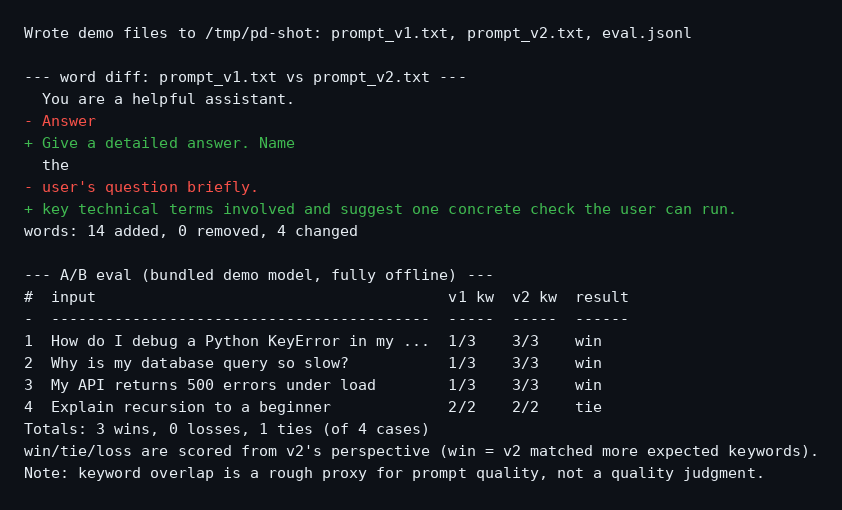

# prompt-diff

[](https://www.python.org/)
[](LICENSE)
[]()

Word-level diffs for prompt versions, plus A/B evals against a labeled eval set.

Tweak a prompt, see exactly which words changed, then check whether the new
version actually does better on your eval cases. Zero dependencies, fully
offline.



*Actual output of `prompt-diff demo` — a word-level diff followed by an A/B
eval with per-case win/tie/loss and totals.*

## Install

Requires Python 3.9+.

```bash
pip install prompt-diff
```

Or from source:

```bash
git clone https://github.com/HimanshuSingh0495/prompt-diff
cd prompt-diff
pip install -e .
```

## Quickstart

**Diff two prompt versions** (word-level, red/green in a terminal, plain when piped):

```bash
prompt-diff v1.txt v2.txt
```

```
  You are a helpful assistant.
- Answer the user's question briefly.
+ Give a detailed answer.
words: 3 added, 0 removed, 5 changed
```

**A/B test them against a labeled eval set** (JSONL with
`{"input": "...", "expected_keywords": [...]}` per line):

```bash
prompt-diff v1.txt v2.txt --eval eval.jsonl
```

This runs both prompts through the bundled fake demo model (deterministic,
keyword-based, no API keys) and prints per-case win/tie/loss plus totals.

**Zero-setup demo** — writes two sample prompts and an eval set to the
current directory, prints the diff, and runs the A/B:

```bash
prompt-diff demo
```

## Python API

Plug in any real model by passing a `model_fn(prompt, case_input) -> str`:

```python
from prompt_diff import run_ab, summarize, load_cases
from prompt_diff.harness import EvalCase

def my_model(prompt: str, case_input: str) -> str:
    return call_your_llm(prompt + "\n\n" + case_input)

cases = load_cases("eval.jsonl")
results = run_ab(open("v1.txt").read(), open("v2.txt").read(), cases, my_model)
print(summarize(results))  # {'wins': 3, 'losses': 0, 'ties': 1, 'total': 4}
```

`verdict` on each result is `"win"`, `"tie"`, or `"loss"` — always from
prompt B's (the new version's) perspective.

## How scoring works (and its limits)

A case is a **win** for a prompt when its output contains **more** of the
case's expected keywords than the other prompt's output; a **loss** when it
contains fewer; a **tie** when the counts are equal. Matching is
case-insensitive substring search, one point per keyword.

Be clear-eyed about what this measures:

- Keyword overlap is a **rough proxy** for prompt quality, not a quality
  judgment. A prompt can hit every keyword and still give a bad answer.
- It says nothing about tone, correctness, safety, or formatting.
- Keywords you choose shape the outcome — the eval set is the test, so write
  it carefully.

For real evaluations, replace the bundled demo model with your actual model
via the Python API and treat keyword scores as one signal among several
(human review, LLM judges, task success rates).

## Eval file format

`eval.jsonl` — one JSON object per line, blank lines ignored:

```jsonl
{"input": "Why is my database query so slow?", "expected_keywords": ["database", "index", "query"]}
{"input": "Explain recursion to a beginner", "expected_keywords": ["explain", "recursion"]}
```

## Development

```bash
python -m venv .venv && source .venv/bin/activate
pip install -e .      # zero runtime dependencies
pip install pytest   # only needed for the test suite
pytest
```

## License

MIT — see [LICENSE](LICENSE).
